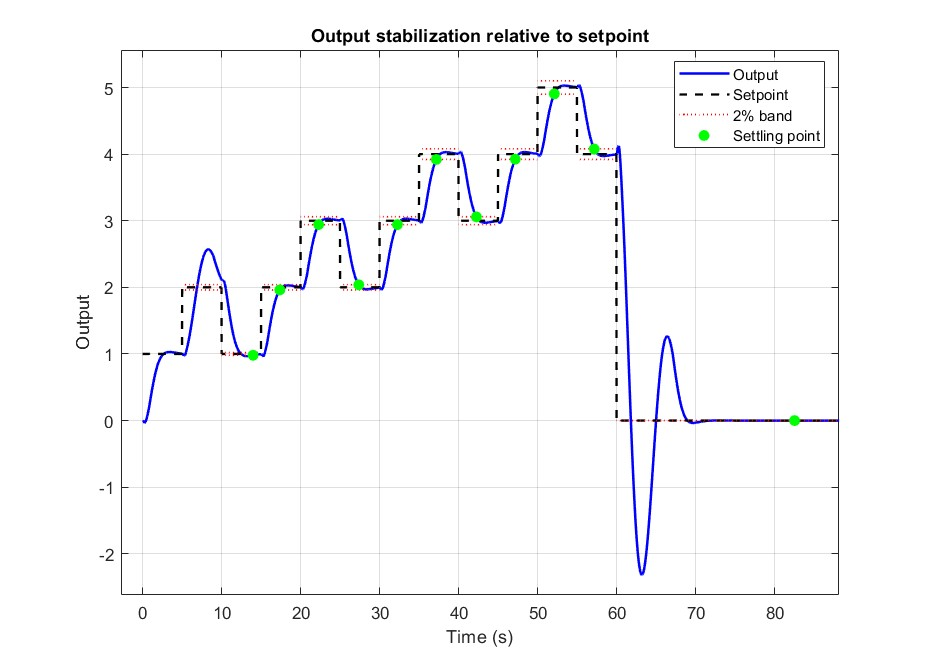
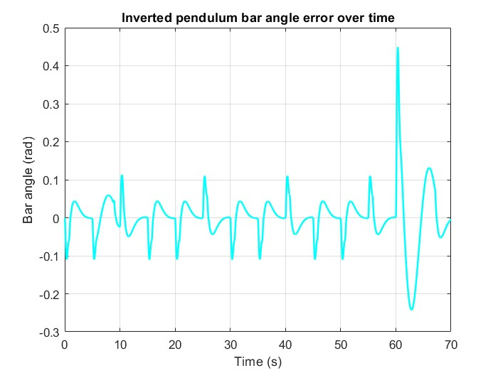
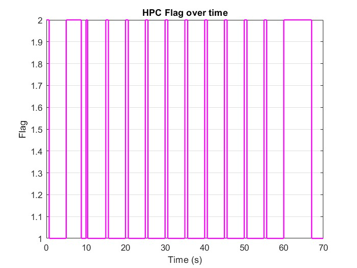

# Simplex Control Architecture — Inverted Pendulum

MATLAB/Simulink implementation of the **Simplex architecture** for safe control of a
cart–pole (inverted pendulum), plus the preparatory exercises on pole placement, LQR,
LMI-based recovery regions and Kalman filtering.



## The Simplex architecture

Simplex runs two controllers side by side and lets a decision module choose which one
drives the plant at every step:

| Component | Role |
|---|---|
| **HPC** — High-Performance Controller (`HPC1.slx`) | Aggressive tracking controller. Good performance, no formal safety guarantee. |
| **HAC** — High-Assurance Controller (`Hac_solver.m`) | State feedback `u = -Kx`, with `K` from an LMI problem. It is provably stable and respects the state and input constraints inside its recovery region. |
| **Decision module** (`rct_pendulum_Simplex_project.slx`) | Predicts the state produced by the HPC command and accepts it only if the prediction stays inside the recovery region `xᵀPx ≤ 1`; otherwise it switches to the HAC. |
| **Setpoint provider** (`Setpointprovider.slx`) | Generates the cart position reference sequence. |

### Safety controller design

The HAC is found by maximising the volume of the invariant ellipsoid
`{x : xᵀ Q⁻¹ x ≤ 1}` (minimise `-log det Q`) subject to:

- **Lyapunov stability:** `QAᵀ + AQ + ZᵀBᵀ + BZ ≺ 0`
- **State constraints:** `|x| ≤ 2.2 m`, `|ẋ| ≤ 5 m/s`, `|θ| ≤ π/6 rad`
- **Input constraint:** `|u| ≤ 30`

Then `P = Q⁻¹` and `K = -Z Q⁻¹`, giving `K ≈ [-7.45  -13.54  101.0  8.88]`. The problem is modelled with
YALMIP and solved with SDPT3.

## Requirements

- MATLAB **R2024b** (the models were saved in R2024b; older releases may not open them)
- Simulink
- Control System Toolbox (`place`, `lqr`, `ss`, `initial`)
- A C compiler supported by MATLAB (e.g. MinGW-w64). Simulink needs it to build the
  referenced models the first time you run a simulation.
- Third-party toolboxes. They are **not included** in this repository:
  - [YALMIP](https://github.com/yalmip/YALMIP)
  - [SDPT3](https://github.com/sqlp/sdpt3)
  - [SeDuMi](https://github.com/sqlp/sedumi) (used by `ex2/Exercise1.m`)

## Setup

1. Clone the repository.
2. Download YALMIP, SDPT3 and SeDuMi ("Code → Download ZIP" on GitHub) and extract them
   into the repository root. The default folder names (`YALMIP-master/`,
   `sdpt3-master/`, `sedumi-master/`) are git-ignored and detected automatically.
   If you already have them on your MATLAB path, skip this step.
3. In MATLAB, from the repository root:

   ```matlab
   setup_paths
   ```

   This adds the project folders and the toolboxes to the path. It also redirects
   Simulink cache and code-generation files to `build/`, which is git-ignored.

## Running the Simplex project

```matlab
cd pendulum
main                                   % linearised cart–pole model: A, B, C, D
Hac_solver                             % solve the LMI -> safety gain K and matrix P
sim('rct_pendulum_Simplex_project')    % 70 s simulation; logs states, setpoint, flag
analysis                               % settling times, HPC acceptance rate, plots
```

The Simulink models keep their parameters in their own Model Workspace, so they can
also be opened and simulated directly. `analysis.m` reads the `states`, `setpoint` and
`flag` variables that the simulation writes to the base workspace. `flag == 1` means
the HPC is active and `flag == 2` means the HAC is active.

Results are documented in [`pendulum/report/Report_SIMPLEX.pdf`](pendulum/report/Report_SIMPLEX.pdf)
and in the simulation video in [`pendulum/video/`](pendulum/video/).

| Pendulum angle | Controller in use (flag) |
|---|---|
|  |  |

## Exercises

Each exercise folder is self-contained. Run `setup_paths` first. **Scripts share the base
workspace, so run them in the order given.**

### `ex1/` — Pole placement and LQR (4-state mass–spring system)

1. Run the first half of `calculate_k.m` (up to `K = place(...)`) to define `A`, `B`,
   `init`, `K`, `Q`, `R` and `K_lqr`.
2. Simulate `step_response.slx`, `pole_placement.slx` and `lqr_sim.slx`
   (e.g. `out = sim('lqr_sim')`).
3. Run `calculate_k.m` to plot the LQR response. It reads `out.lqr_vars`.

### `ex2/` — LMI optimisation and recovery regions (6-state system, 2 inputs)

| Script | Content |
|---|---|
| `Exercise1.m` | Warm-up linear program with YALMIP + SeDuMi |
| `Exercise2_1.m` | LQR designs for two weightings, simulated from `x0` |
| `Exercise2_2.m` | Recovery regions of the LQR controllers (needs `Exercise2_1` first) |
| `Exercise2_3.m` | Maximum-volume recovery region via LMI (SDPT3) |
| `Exercise2_4.m` | Closed-loop simulation with the maximal-volume gain (needs `Exercise2_3` first) |

`utils/` holds the plotting and metric helpers (`plot_states`, `analyze_value`), and
`imgs/` holds the resulting figures. Full write-up: [`ex2/Report_ex2.pdf`](ex2/Report_ex2.pdf).

### `ex3/` — Sensor acquisition and Kalman filter (Raspberry Pi)

Found under `ex3/home/pi/Documents/`:

- `data_sensing.c`, `ads1115.c/.h`: periodic (50 Hz) voltage sampling from an ADS1115 ADC
  over I²C using wiringPi. Build and run it on the Raspberry Pi.
- `measurement.txt`: recorded samples (voltage, time).
- `thermalnoise_est.m`: estimates the measurement noise variance from the spectrum.
- `kalman.m`: 1-D Kalman filter on the recorded measurements.

## Repository layout

```
setup_paths.m          path setup (run first)
pendulum/              Simplex architecture — main project
ex1/                   pole placement & LQR
ex2/                   LMI / recovery regions
ex3/                   ADC acquisition & Kalman filter
```

## Third-party software

This project depends on YALMIP (J. Löfberg), SDPT3 (Toh, Todd, Tütüncü; GPL-2.0) and
SeDuMi (GPL-2.0). They are distributed separately under their own licences. YALMIP asks
to be cited in published work:

> J. Löfberg, "YALMIP: A Toolbox for Modeling and Optimization in MATLAB," *Proc. CACSD
> Conference*, Taipei, Taiwan, 2004.
